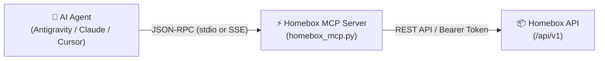

# Homebox MCP Server 📦🤖

[](https://github.com/jlowin/fastmcp)
[](https://homebox.software/)
[](https://opensource.org/licenses/MIT)
[](https://github.com/lmolent/homebox-mcp/pkgs/container/homebox-mcp)

Production-grade **Model Context Protocol (MCP)** server for the self-hosted [Homebox](https://homebox.software/) inventory management system. Enables autonomous **AI agents** (Google Antigravity, Claude Desktop, Cursor, Claude Code, Cline, and others) to seamlessly interact with physical inventories — finding items, navigating location hierarchies, creating and moving items, logging vehicle/tool maintenance, and managing tags.

---

## 📑 Table of Contents
- [Architecture](#-architecture)
- [Installation & Configuration](#-installation--configuration)
  - [1. Prerequisites](#1-prerequisites)
  - [2. Environment Variables](#2-environment-variables)
  - [3. Configuration for MCP Clients](#3-configuration-for-mcp-clients)
  - [4. Docker Deployment (GHCR Image)](#4-docker-deployment-ghcr-image)
- [Tools Reference](#-tools-reference)
  - [📍 Locations & Hierarchy](#-locations--hierarchy)
  - [🔍 Search & Navigation](#-search--navigation)
  - [📦 Item Management](#-item-management)
  - [🔧 Maintenance & Service Logs](#-maintenance--service-logs)
  - [🏷 Tags, Statistics & Attachments](#-tags-statistics--attachments)
- [Instructions & Best Practices for AI Agents](#-instructions--best-practices-for-ai-agents)
- [Common Agent Workflows](#-common-agent-workflows)
- [Testing](#-testing)
- [License](#-license)

---

## 🏛 Architecture

The MCP server bridges LLM agents with Homebox's REST API. It is built on modern `FastMCP` and `httpx` with PEP 723 inline script dependency metadata for effortless execution via `uv`.



---

## 🚀 Installation & Configuration

### 1. Prerequisites
- [uv](https://github.com/astral-sh/uv) (recommended Python package manager) or Python 3.10+
- A running Homebox instance with API enabled
- Homebox API key (*User Settings -> API Keys*)

### 2. Environment Variables
Copy `.env.example` to `.env`:
```bash
cp .env.example .env
```
Configure your Homebox instance URL and API key:
```env
HOMEBOX_URL=https://homebox.yourdomain.com
HOMEBOX_API_KEY=hb_your_homebox_api_key_here
```

### 3. Configuration for MCP Clients

#### Google Antigravity (`mcp_config.json`)
```json
{
  "mcpServers": {
    "homebox": {
      "command": "uv",
      "args": ["run", "/path/to/homebox-mcp/homebox_mcp.py"],
      "env": {
        "HOMEBOX_URL": "https://homebox.yourdomain.com",
        "HOMEBOX_API_KEY": "hb_your_homebox_api_key_here"
      }
    }
  }
}
```

#### Claude Desktop (`claude_desktop_config.json`)
```json
{
  "mcpServers": {
    "homebox": {
      "command": "uv",
      "args": ["run", "/path/to/homebox-mcp/homebox_mcp.py"],
      "env": {
        "HOMEBOX_URL": "https://homebox.yourdomain.com",
        "HOMEBOX_API_KEY": "hb_your_homebox_api_key_here"
      }
    }
  }
}
```

### 4. Docker Deployment (GHCR Image)

Pre-built multi-architecture Docker images (`linux/amd64` and `linux/arm64`) are automatically published to the **GitHub Container Registry (GHCR)**.

#### A. Running via Docker in MCP Clients (`stdio` mode)
No local Python or dependencies required. The MCP client runs the container directly:

```json
{
  "mcpServers": {
    "homebox": {
      "command": "docker",
      "args": [
        "run",
        "-i",
        "--rm",
        "-e", "HOMEBOX_URL=https://homebox.yourdomain.com",
        "-e", "HOMEBOX_API_KEY=hb_your_homebox_api_key_here",
        "ghcr.io/lmolent/homebox-mcp:latest"
      ]
    }
  }
}
```

#### B. Running as a Network Service (`sse` transport)
For remote or web-based agents that connect over Server-Sent Events (SSE):

```bash
docker run -d \
  --name homebox-mcp \
  -p 8000:8000 \
  -e MCP_TRANSPORT=sse \
  -e PORT=8000 \
  -e HOMEBOX_URL=https://homebox.yourdomain.com \
  -e HOMEBOX_API_KEY=hb_your_homebox_api_key_here \
  ghcr.io/lmolent/homebox-mcp:latest
```

---

## 🛠 Tools Reference

### 📍 Locations & Hierarchy
| Tool | Description | When to use |
| :--- | :--- | :--- |
| `list_locations()` | Returns a flat list of all locations with their UUID and `full_path`. | **Call this first** to discover valid location IDs before placing or moving items. |
| `create_location(name, description, parent_id)` | Creates a new physical location, room, vehicle, shelf, or building. | When user asks to *"Create a Workshop location"* or *"Add shelf B to Garage"*. |
| `location_tree(with_items)` | Returns the full nested hierarchy tree (optionally including items). | For comprehensive exploratory overviews of storage structures. |
| `move_item(id, new_parent_id)` | Moves an item or sub-location into a new parent container. | When user asks to *"Move the drill from Garage to Workshop"*. |

### 🔍 Search & Navigation
| Tool | Description | When to use |
| :--- | :--- | :--- |
| `search_items(query, parent_ids, tag_ids, page, page_size)` | Searches items by text with optional parent location or tag filters. | Primary starting point for queries like *"Where is the socket set?"* or *"What is inside the Jeep?"*. |
| `get_item_path(id)` | Returns the hierarchical breadcrumb chain from root to entity. | **Essential for "Where is X?" queries** — returns e.g. `Garage 2 > Tool Cabinet > Top Shelf > Screwdriver`. |
| `get_item(id)` | Returns complete entity details by UUID. | To inspect serial numbers, purchase price, warranty, attachments, and notes. |
| `get_item_by_asset_id(asset_id)` | Finds an item by short Homebox asset label (e.g. `000-015`). | When user provides a sticker code or asset tag. |
| `search_by_barcode(barcode)` | Look up product info by barcode or EAN number. | When scanning barcodes or EAN codes. |

### 📦 Item Management
| Tool | Description | When to use |
| :--- | :--- | :--- |
| `create_item(...)` | Creates a new item with metadata (serial number, model, brand, price, notes). | When registering new tools, electronics, or equipment. |
| `update_item(id, fields)` | Safely updates entity fields via `PUT` with automatic state merge. | When changing quantity, description, notes, price, or serial number. |
| `delete_item(id)` | Deletes an item or location by UUID. | When decommissioning or discarding an item. |
| `duplicate_item(id, copy_prefix)` | Clones an existing item with its attributes. | When recording multiple units of identical tools or gear. |

### 🔧 Maintenance & Service Logs
| Tool | Description | When to use |
| :--- | :--- | :--- |
| `create_maintenance_entry(...)` | Records completed or scheduled service (date, name, description, cost). | For vehicles, tools, and appliances (oil changes, inspections, bike service). |
| `get_maintenance_log(entity_id)` | Retrieves complete service history for an entity. | When answering *"When was the oil last changed?"* or *"How much did bike maintenance cost?"*. |

### 🏷 Tags, Statistics & Attachments
| Tool | Description | When to use |
| :--- | :--- | :--- |
| `list_tags()` | Lists all registered tags. | To check existing category tags. |
| `create_tag(name, description, color, parent_id)` | Creates a new tag. | When user wants a new category (e.g. *"Automotive"*). |
| `delete_tag(id)` | Deletes a tag by UUID. | Tag category management. |
| `get_statistics()` | Returns overall inventory statistics (counts, value, warranties). | Answering questions like *"How many items do I have?"* or *"What is my total gear value?"*. |
| `add_external_link(entity_id, title, url)` | Attaches a web link (manual, datasheet, product page, receipt URL). | Adding digital documentation to physical equipment. |

---

## 🧠 Instructions & Best Practices for AI Agents

Follow these guidelines for 100% accuracy and zero hallucinations:

1. **Items vs. Locations**:
   - Locations represent physical spaces or containers (room, garage, car, shelf, box). Always create them using `create_location`.
   - Items represent physical objects stored within locations. Always create them using `create_item` and **always provide `parent_id`** (destination container).
2. **"Where is item X?" (Breadcrumbs)**:
   - When asked where an item is located, first call `search_items(query="...")`.
   - Then call **`get_item_path(id)`** on the matching item.
   - Reply with the complete hierarchical chain, e.g.: *"The 'WD40' is located in: Garage 2 > Chemical Cabinet > Top Shelf."*
3. **Inspecting Location Contents**:
   - When asked *"What is inside the Jeep?"*, do NOT fetch the entire `location_tree(with_items=True)`. Instead, find the location ID via `list_locations()` and call `search_items(parent_ids=[jeep_id])`.
4. **Discovering Destination IDs**:
   - Before calling `create_item` or `move_item`, call `list_locations()`. Inspect the `full_path` field to find the corresponding UUID.
5. **Vehicle & Tool Service Logs**:
   - For vehicles and machinery (car, caravan, lawnmower, bicycle), record service via `create_maintenance_entry`. Provide dates in ISO `YYYY-MM-DD` format and costs in the `cost` field.

---

## 💡 Common Agent Workflows

### Scenario A: Finding the Exact Location of an Item
> **User**: *"Where is my socket set?"*
1. Agent calls `search_items(query="Socket set")`.
2. Receives results: `Small Socket Set` (ID: `fc8031e8...`) and `Large Socket Set` (ID: `eaba5497...`).
3. Agent calls `get_item_path(id="fc8031e8...")` and `get_item_path(id="eaba5497...")`.
4. Breadcrumbs:
   - `Small Socket Set`: `Jeep > Trunk`
   - `Large Socket Set`: `Caravan > Storage Compartment`
5. Agent responds clearly with the exact locations of both sets.

### Scenario B: Moving an Item to a New Container
> **User**: *"Create a new cabinet 'Tools' in Garage 1 and move the drill there."*
1. Agent calls `list_locations()` and retrieves the ID for `Garage 1` (`8587d8b0...`).
2. Agent calls `create_location(name="Tools", parent_id="8587d8b0...")` -> receives new cabinet ID.
3. Agent finds the drill via `search_items(query="Drill")` -> retrieves drill ID.
4. Agent calls `move_item(id=drill_id, new_parent_id=tools_cabinet_id)`.
5. Agent confirms the creation and relocation.

### Scenario C: Logging Maintenance & Service
> **User**: *"I changed the engine oil and filter on the Jeep today, it cost 85 EUR."*
1. Agent finds the Jeep entity via `search_items(query="Jeep")`.
2. Agent calls `create_maintenance_entry`:
   ```json
   {
     "entity_id": "58451a42-c1fa-4f84-b011-6a402670a2de",
     "name": "Engine oil and filter change",
     "cost": "85.00",
     "completed_date": "2026-10-13",
     "description": "Scheduled engine oil (5W-30) and oil filter replacement."
   }
   ```
3. Agent confirms the maintenance log entry in the Jeep's service history.

---

## 🧪 Testing

The repository includes an end-to-end integration test suite `test_mcp_tools.py` that validates all 21 tools against a running Homebox instance and automatically cleans up test data:

```bash
uv run test_mcp_tools.py
```

Sample output:
```text
=== 1. Testing get_statistics() ===
Stats: {'totalUsers': 1, 'totalItems': 21, 'totalLocations': 10, ...}
=== 2. Testing list_locations() ===
Found 10 locations.
...
>>> ALL TESTS PASSED SUCCESSFULLY! <<<
```

---

## 📄 License

This project is licensed under the [MIT License](LICENSE).
