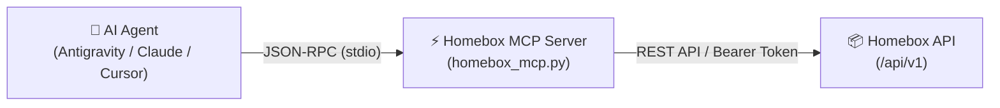

# Homebox MCP Server 📦🤖

[](https://github.com/jlowin/fastmcp)
[](https://homebox.software/)
[](https://opensource.org/licenses/MIT)

Produkčný **Model Context Protocol (MCP)** server pre samoobslužný inventárny systém [Homebox](https://homebox.software/). Umožňuje autonómnym **AI agentom** (Antigravity, Claude Desktop, Cursor, Claude Code, Cline a ďalším) plnohodnotne pracovať s fyzickým inventárom — vyhľadávať veci, navigovať v hierarchii lokácií, evidovať nové predmety a umiestnenia, zaznamenávať servis/údržbu techniky a spravovať štítky.

---

## 📑 Obsah
- [Architektúra](#-architektúra)
- [Inštalácia a konfigurácia](#-inštalácia-a-konfigurácia)
- [Prehľad nástrojov (Tools Reference)](#-prehľad-nástrojov-tools-reference)
- [Inštrukcie a Best Practices pre AI agentov](#-inštrukcie-a-best-practices-pre-ai-agentov)
- [Typické scenáre (Agent Workflows)](#-typické-scenáre-agent-workflows)
- [Testovanie](#-testovanie)
- [Licencia](#-licencia)

---

## 🏛 Architektúra

MCP server prepája LLM asistenta s REST API Homeboxu. Je postavený na modernom `FastMCP` a `httpx` s podporou inline definície závislostí podľa PEP 723 pre jednoduché spustenie cez `uv`.



---

## 🚀 Inštalácia a konfigurácia

### 1. Požiadavky
- [uv](https://github.com/astral-sh/uv) (odporúčaný Python balíčkovač) alebo Python 3.10+
- Bežiaca inštancia Homeboxu s povoleným API
- API kľúč z Homeboxu (*Nastavenia používateľa -> API kľúče*)

### 2. Lokálne premenné prostredia
Skopírujte šablónu `.env.example` do `.env`:
```bash
cp .env.example .env
```
Nastavte URL vašej Homebox inštancie a vygenerovaný API kľúč:
```env
HOMEBOX_URL=https://hb.vasedomena.sk
HOMEBOX_API_KEY=hb_VASHOMEBOXAPIKEY
```

### 3. Konfigurácia pre MCP klientov

#### Google Antigravity (`mcp_config.json`)
```json
{
  "mcpServers": {
    "homebox": {
      "command": "uv",
      "args": ["run", "/cesta/k/homebox-mcp/homebox_mcp.py"],
      "env": {
        "HOMEBOX_URL": "https://hb.vasedomena.sk",
        "HOMEBOX_API_KEY": "hb_VASHOMEBOXAPIKEY"
      }
    }
  }
}
```

#### Claude Desktop (`claude_desktop_config.json`)
```json
{
  "mcpServers": {
    "homebox": {
      "command": "uv",
      "args": ["run", "/cesta/k/homebox-mcp/homebox_mcp.py"],
      "env": {
        "HOMEBOX_URL": "https://hb.vasedomena.sk",
        "HOMEBOX_API_KEY": "hb_VASHOMEBOXAPIKEY"
      }
    }
  }
}
```

---

## 🛠 Prehľad nástrojov (Tools Reference)

### 📍 Lokácie a hierarchia (Locations)
| Nástroj | Popis | Kedy použiť |
| :--- | :--- | :--- |
| `list_locations()` | Vráti plochý zoznam všetkých lokácií s ich ID a reťazcom `full_path`. | **Zavolať ako prvé**, keď používateľ chce niekam uložiť alebo presunúť vec, aby agent zistil platné ID lokácie. |
| `create_location(name, description, parent_id)` | Vytvorí novú fyzickú lokáciu (miestnosť, budovu, auto, regál, krabicu). | Keď používateľ povie *"Vytvor novú lokáciu Dielňa"* alebo *"Pridaj poličku do Garáže"*. |
| `location_tree(with_items)` | Vráti stromovú štruktúru lokácií (voliteľne aj s položkami). | Pri komplexnom prieskume štruktúry skladu/domácnosti. |
| `move_item(id, new_parent_id)` | Presunie položku alebo pod-lokáciu do iného umiestnenia. | Keď používateľ povie *"Presuň vŕtačku z Garáže do Dielne"*. |

### 🔍 Vyhľadávanie a navigácia (Search & Query)
| Nástroj | Popis | Kedy použiť |
| :--- | :--- | :--- |
| `search_items(query, parent_ids, tag_ids, page, page_size)` | Vyhľadáva položky podľa textu s voliteľným filtrom na lokácie a štítky. | Východiskový bod pre otázky typu *"Kde mám gola sadu?"* alebo *"Čo je v Jeepe?"*. |
| `get_item_path(id)` | Vráti hierarchickú cestu od koreňa po entitu (breadcrumbs). | **Kritické pri otázke "Kde je X?"** — agent zistí napr. `Garáž 2 > Skrinka > Polica 3 > Skrutkovač`. |
| `get_item(id)` | Vráti kompletné detaily entity podľa jej UUID. | Na zistenie sériového čísla, nákupnej ceny, záruky, príloh a detailného popisu. |
| `get_item_by_asset_id(asset_id)` | Nájde položku podľa fyzického štítku Homeboxu (napr. `000-015`). | Keď používateľ odčíta štítok s číslom alebo QR kódom. |
| `search_by_barcode(barcode)` | Vyhľadá produkt podľa EAN / čiarového kódu. | Pri skenovaní čiarových kódov produktov. |

### 📦 Správa položiek (Item Management)
| Nástroj | Popis | Kedy použiť |
| :--- | :--- | :--- |
| `create_item(...)` | Zaeviduje nový predmet s voliteľnými detailmi (sériové číslo, model, výrobca, cena, poznámky). | Pri pridávaní nového náradia, elektroniky či vybavenia. |
| `update_item(id, fields)` | Bezpečne aktualizuje ľubovoľné polia entity cez `PUT` (s automatickým zlúčením stavu). | Pri úprave množstva, popisu, ceny, poznámok alebo sériového čísla. |
| `delete_item(id)` | Zmaže položku alebo lokáciu podľa ID. | Pri vyradení položky. |
| `duplicate_item(id, copy_prefix)` | Vytvorí kópiu existujúcej položky. | Pri evidencii viacerých kusov rovnakého náradia alebo techniky. |

### 🔧 Údržba a servis techniky (Maintenance)
| Nástroj | Popis | Kedy použiť |
| :--- | :--- | :--- |
| `create_maintenance_entry(...)` | Zaznamená vykonaný alebo plánovaný servis (dátum, názov, popis, cena). | Pre autá, stroje a techniku (napr. výmena oleja na Jeepe, STK, servis bicykla). |
| `get_maintenance_log(entity_id)` | Vráti celú servisnú históriu danej položky. | Pri otázke *"Kedy bol naposledy menený olej?"* alebo *"Koľko stál servis bicykla?"*. |

### 🏷 Štítky, štatistiky a prílohy (Metadata & Attachments)
| Nástroj | Popis | Kedy použiť |
| :--- | :--- | :--- |
| `list_tags()` | Zoznam všetkých štítkov. | Zistenie existujúcich kategórií. |
| `create_tag(name, description, color, parent_id)` | Vytvorenie nového štítku. | Keď používateľ chce novú kategóriu (napr. *"Autovýbava"*). |
| `delete_tag(id)` | Zmazanie štítku. | Správa kategórií. |
| `get_statistics()` | Celkové štatistiky inventára (počty, hodnota, záruky). | Na otázky *"Koľko vecí mám celkovo?"* alebo *"Aká je hodnota vybavenia?"*. |
| `add_external_link(entity_id, title, url)` | Pridá k položke webový odkaz (návod, eshop, PDF dokument). | Priloženie online dokumentácie k náradiu či zariadeniu. |

---

## 🧠 Inštrukcie a Best Practices pre AI agentov

Pre dosiahnutie 100% presnosti a nulových halucinácií dodržiavajte tieto pravidlá:

1. **Rozdiel medzi položkou (Item) a umiestnením (Location)**:
   - Lokácie reprezentujú fyzické miesta alebo väčšie kontajnery (izba, garáž, auto, regál, kufor). Vytvárajte ich výhradne cez `create_location`.
   - Položky reprezentujú predmety umiestnené v lokáciách. Vytvárajte ich cez `create_item` a **vždy sa snažte uviesť `parent_id`** (kam predmet patrí).
2. **Kde je vec? (Lokalizačný reťazec)**:
   - Keď sa používateľ opýta *"Kde je [vec]?"*, najprv zavolajte `search_items(query="...")`.
   - Následne na nájdené ID zavolajte **`get_item_path(id)`**.
   - Odpovedzte používateľovi celým reťazcom, napr.: *„Položka 'WD40' sa nachádza v: Garáž 2 > Skrinka na chémiu > Horná polica.“*
3. **Zisťovanie obsahu lokácie**:
   - Ak sa používateľ pýta napr. *"Čo mám v aute Jeep?"*, nezvolávajte celý `location_tree(with_items=True)`, ale nájdite ID lokácie Jeep cez `list_locations()` a potom zavolajte `search_items(parent_ids=[jeep_id])`.
4. **Zistenie ID cieľovej lokácie**:
   - Pred volaním `create_item` alebo `move_item` použite `list_locations()`. Prejdite pole `full_path` a nájdite zodpovedajúce ID.
5. **Servisné záznamy**:
   - Pre vozidlá a techniku (auto, karavan, kosačka, bicykel) evidujte servis cez `create_maintenance_entry`. Uvádzajte dátum v ISO formáte `YYYY-MM-DD` a náklady v poli `cost`.

---

## 💡 Typické scenáre (Agent Workflows)

### Scenár A: Zistenie presnej polohy predmetu
> **Používateľ**: *"Kde mám gola sadu?"*
1. Agent zavolá `search_items(query="Gola sada")`.
2. Získa položky, napr. `Gola sada malá` (ID: `fc8031e8...`) a `Gola sada veľká` (ID: `eaba5497...`).
3. Agent zavolá `get_item_path(id="fc8031e8...")` a `get_item_path(id="eaba5497...")`.
4. Výsledok:
   - `Gola sada malá`: `Jeep > Kufor`
   - `Gola sada veľká`: `Karavan > Úložný priestor`
5. Agent zrozumiteľne odpovie s presným umiestnením oboch sád.

### Scenár B: Presun predmetu do nového miesta
> **Používateľ**: *"Vytvor novú skrinku 'Náradie' v Garáži 1 a presuň tam vŕtačku."*
1. Agent zavolá `list_locations()` a nájde ID pre `Garáž 1` (`8587d8b0...`).
2. Agent zavolá `create_location(name="Náradie", parent_id="8587d8b0...")` -> získa ID novej skrinky.
3. Agent nájde vŕtačku cez `search_items(query="Vŕtačka")` -> získa ID vŕtačky.
4. Agent zavolá `move_item(id=vrtacka_id, new_parent_id=nova_skrinka_id)`.
5. Agent potvrdí úspešné vytvorenie a presun.

### Scenár C: Záznam servisu a údržby
> **Používateľ**: *"Dnes som na Jeepe vymenil motorový olej a filter, stálo to 85 eur."*
1. Agent nájde entitu Jeep cez `search_items(query="Jeep")`.
2. Agent zavolá `create_maintenance_entry`:
   ```json
   {
     "entity_id": "58451a42-c1fa-4f84-b011-6a402670a2de",
     "name": "Výmena motorového oleja a filtra",
     "cost": "85.00",
     "completed_date": "2026-10-13",
     "description": "Pravidelný servis motorového oleja a olejového filtra."
   }
   ```
3. Agent informuje o zaevidovaní servisného záznamu do servisnej knihy Jeepu.

---

## 🧪 Testovanie

Repozitár obsahuje komplexný automatizovaný integračný test `test_mcp_tools.py`, ktorý otestuje všetky funkcie proti bežiacej inštancii Homeboxu a automaticky po sebe vyčistí všetky testovacie dáta:

```bash
uv run test_mcp_tools.py
```

Výstup testu:
```text
=== 1. Testing get_statistics() ===
Stats: {'totalUsers': 1, 'totalItems': 21, 'totalLocations': 10, ...}
=== 2. Testing list_locations() ===
Found 10 locations.
...
>>> ALL TESTS PASSED SUCCESSFULLY! <<<
```

---

## 📄 Licencia

Tento projekt je zverejnený pod licenciou [MIT](LICENSE).
